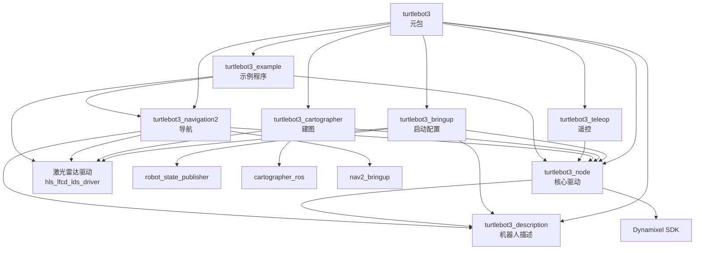
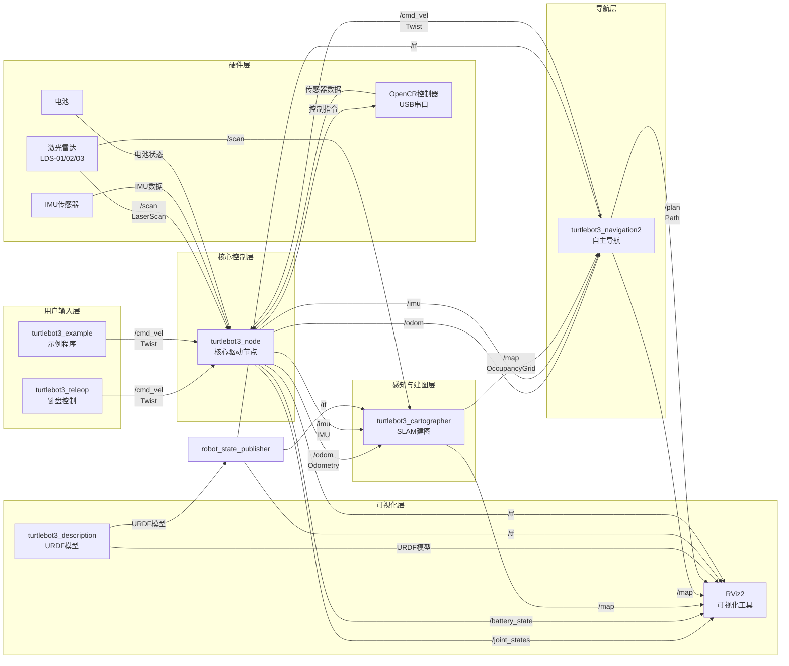
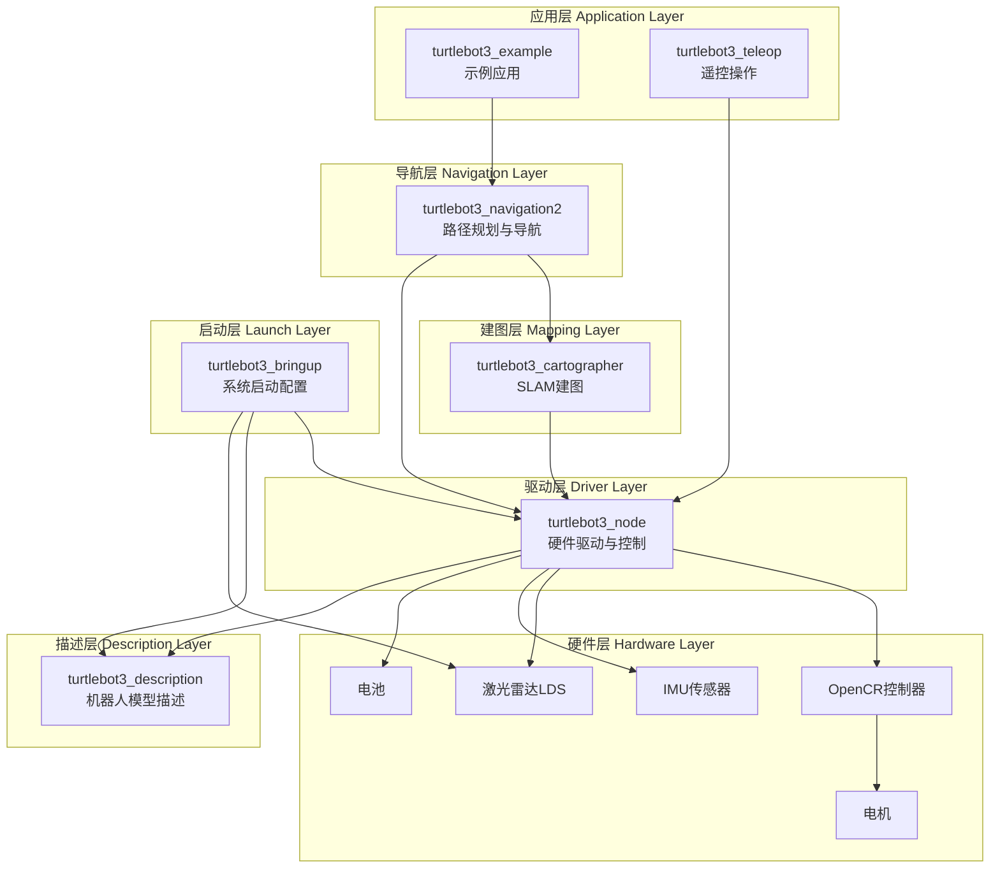
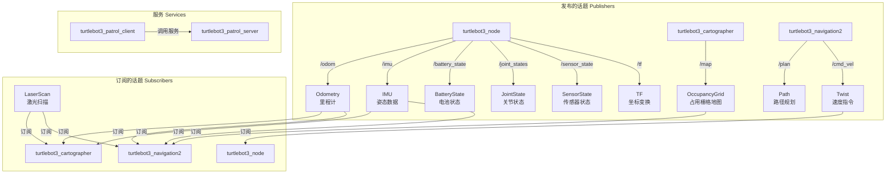
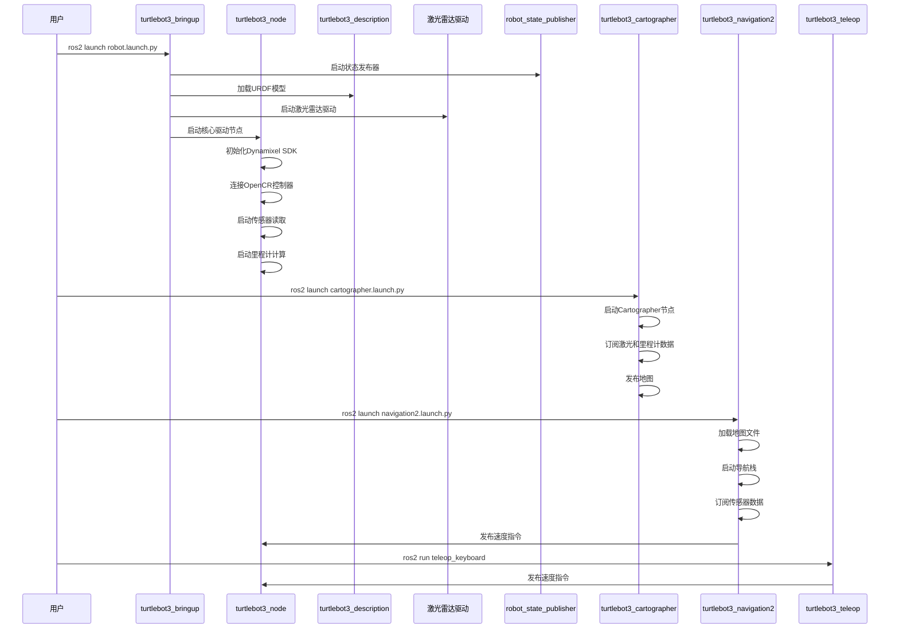

# TurtleBot3 模块关系图

## 1. 模块依赖关系图

## 2. 数据流关系图

## 3. 功能层次架构图

## 4. ROS 2 话题与服务关系图

## 5. 启动流程关系图

## 6. 模块功能矩阵

| 模块 | 主要功能 | 输入 | 输出 | 依赖 |
|------|---------|------|------|------|
| **turtlebot3_node** | 硬件驱动、运动控制、传感器数据 | /cmd_vel | /odom, /imu, /battery_state, /joint_states, /tf | Dynamixel SDK, turtlebot3_description |
| **turtlebot3_bringup** | 系统启动配置 | - | 启动所有节点 | turtlebot3_node, turtlebot3_description, 激光雷达驱动 |
| **turtlebot3_description** | 机器人模型定义 | - | URDF模型 | - |
| **turtlebot3_cartographer** | SLAM建图 | /scan, /odom, /imu | /map | cartographer_ros, turtlebot3_node |
| **turtlebot3_navigation2** | 自主导航 | /map, /scan, /odom, /imu | /cmd_vel, /plan | nav2_bringup, turtlebot3_node |
| **turtlebot3_teleop** | 键盘遥控 | 键盘输入 | /cmd_vel | - |
| **turtlebot3_example** | 示例程序 | 程序逻辑 | /cmd_vel, 服务调用 | turtlebot3_node, turtlebot3_navigation2 |

## 说明

- **实线箭头**：表示模块依赖关系
- **虚线箭头**：表示数据流（ROS话题/服务）
- **颜色分组**：相同颜色的模块属于同一功能层次
- **双向箭头**：表示双向通信关系

